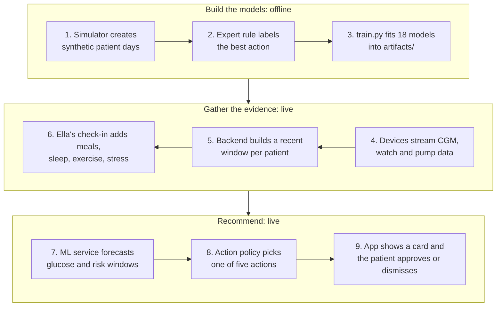

# GlucoLoop

GlucoLoop is a hackathon prototype that helps a person with diabetes who wears
an insulin pump decide what the pump should do next. It watches their device
readings, asks them short questions in a chat, forecasts where their blood
glucose is heading, and then recommends one pump action with a reason. The
patient always makes the final decision. GlucoLoop never changes the pump on
its own.

## What problem this solves

An insulin pump user makes dozens of small decisions a day. They decide whether
to eat, whether to correct a high reading, whether to trust a sensor that looks
odd, or whether to turn insulin down before exercise. Today they make these
decisions by combining three sources by hand. The first is the glucose sensor.
The second is the pump's own record of the insulin it has delivered. The third
is what they know about their own day, such as a large lunch or a poor night's
sleep.

GlucoLoop puts all three sources together. It reads the devices continuously,
gathers the personal context through a friendly chat assistant called Ella, and
feeds both into machine-learning models. The models do two jobs. They forecast
glucose over the next hour and the next day, and they suggest one of five pump
actions. Because a chat answer changes the models' inputs, telling Ella "I just
ate 60 g of carbohydrate" visibly moves every forecast and can change the
recommendation.

## Glossary

| Term | Meaning |
|---|---|
| CGM | Continuous glucose monitor. A skin sensor that reports glucose every 5 minutes, in mg/dL. |
| Basal | The slow, steady background insulin a pump delivers all day. |
| Bolus | A one-off dose, usually for a meal or to correct a high reading. |
| IOB | Insulin on board, meaning insulin delivered but not yet used up. Here it is measured as the deviation from normal basal delivery. |
| Feature vector | The fixed list of numbers describing "the situation now" that every model receives. |
| Fusion service | The backend that merges device readings and chat answers into that feature vector. |
| Envelope | A low-to-high band that glucose is expected to stay within during a time block. |
| q10 / q90 | The 10th and 90th percentiles. A q10 of 80 means "only a 10% chance of going below 80". |
| Device fault | A sensor that drifts or drops out, or a blocked pump line (an "occlusion"). |

## How it works

The diagram shows the process in reading order. The top row happens once,
offline, to build the models. The second and third rows happen continuously
while the demo runs. Read the middle row from right to left.



| Boxes | Where it lives | Command |
|---|---|---|
| 1 | `services/simulator/generate_dataset.py` | `python generate_dataset.py ...` |
| 2 and 3 | `services/ml/train.py` | `python -u train.py` |
| 4 | `services/simulator/live_stream.py` | `python live_stream.py ...` |
| 5 and 6 | `services/backend/` | `node src/server.js` |
| 7 and 8 | `services/ml/predict_api.py` | `python predict_api.py` |
| 9 | `apps/mobile/` | `npx expo start` |

## How the models learn

Real patient data is hard to obtain for a hackathon, so the training data comes
from a physiological simulator. It is built on the Bergman minimal model, a
standard set of equations describing how glucose and insulin interact in the
body. On top of that, it adds meals, exercise, stress, sleep and deliberate
device faults, and it produces many labelled days of synthetic patients.

The central idea is how the "correct" pump action is labelled. While generating
data, the simulator knows what really happens next. An expert rule uses that
knowledge of the future to choose the best action at each moment. The action
model is then trained to reproduce the expert's choice using only information
that would be available in real time. In effect, the model learns to act as if
it could see the future, without actually seeing it. This is also its main
weakness. It can only be as good as the expert rule, and only within the kinds
of situations the simulator produces.

There are 18 models, all scikit-learn gradient-boosted trees, and each is
trained separately:

| Models | Count | Output |
|---|---|---|
| Point forecasts | 5 | Glucose 5, 15, 30, 45 and 60 minutes ahead |
| Day envelope | 12 | For each of the next six 4-hour blocks, the q10 of the lowest glucose and the q90 of the highest. Blocks that may go too low or too high become "risk windows". |
| Action policy | 1 | One of `no_op`, `alarm_only`, `reduce_basal`, `suspend`, `correction_bolus` |

The prediction service loads all 18 model files when the first prediction
request arrives. If any file is missing, that request fails with an error
rather than quietly returning partial results. Evaluation results on separate
held-out scenarios are in `docs/METRICS.md`. In the current draft, the one-hour
forecast is off by about 7.5 mg/dL on average. The action policy is 90%
accurate, but `suspend` and `correction_bolus` never occurred in the training
data, so it cannot yet recommend them.

## Running it

Each service runs in its own terminal. Start them in this order, because each
one calls the one before it.

```bash
# 1) ML prediction service on port 8101, from services/ml
pip install -r requirements.txt
python predict_api.py            # or: uvicorn predict_api:app --port 8101

# 2) Backend fusion service and chat agent on port 8100 (Node 18+, no installs), from services/backend
node src/server.js               # set MISTRAL_API_KEY for the real Ella, otherwise a scripted mock is used

# 3) Simulated devices, from services/simulator
#    --accel 60 plays one simulated minute per real second
python live_stream.py --backend http://127.0.0.1:8100 --patient demo-001 --accel 60

# 4) Mobile app (Expo, a tool for running React Native apps on a phone), from apps/mobile
EXPO_PUBLIC_API_URL=http://<your-computer's-local-network-IP>:8100 npx expo start
```

To check that the ML service is up, run `curl http://127.0.0.1:8101/health`,
which should return a small JSON status. The simulator in step 3 injects
scripted faults so that the demo shows the safety behaviour. CGM drift starts
at simulated minute 600, a pump occlusion at 1500 and a CGM dropout at 2100.

### Retraining from scratch

```bash
cd services/simulator && python generate_dataset.py --n-train 24 --n-eval 6 --days 3
cd services/ml && OMP_NUM_THREADS=2 python -u train.py   # rewrites artifacts/ and docs/METRICS.md
```

Training runs four worker processes in parallel. Each worker limits its
numerical libraries to `OMP_NUM_THREADS` threads (two by default) and prints
the limit it actually applied. Without that limit, four workers would each grab
every CPU core and slow one another down. Each model is saved as soon as it
finishes.

## Configuration and tests

Settings live in `services/ml/config.toml` rather than in the code. The file
sets the forecast horizons, the number and length of the day blocks, the
worker and thread counts, and the latency benchmark targets. Change values
there, then retrain.

From `services/ml`, `python -m unittest test_features test_prediction test_training`
runs the tests. None of them call external services. `python benchmark.py`
measures prediction response times and writes `docs/LATENCY.json`. The
target is that 95% of requests finish within 100 ms.

## Repository layout

| Path | Contents | Owner [delete this column after the hackathon] |
|---|---|---|
| `services/simulator/` | Physiology model, fault injection, data generation, live stream | Eng 1 |
| `services/backend/` | REST API, fusion window, Ella agent and its tools | Eng 2 |
| `services/ml/` | Training, prediction API, config, tests, benchmark | Eng 3 |
| `apps/mobile/` | Expo app with recommendation cards | Eng 4 |
| `packages/contracts/index.ts` | Shared payload types. Update these if you change a payload. | Team |
| `docs/` | `DEMO_SCRIPT.md`, `METRICS.md`, `LATENCY.json`, `WORK_PLAN.md` | Presenter |

`DESIGN_CHOICES.md` records why things were done a certain way, and
`DEFERRED_WORK.md` lists agreed work that has not been done yet.

## Known limitations

- All state is held in memory, so restarting the backend loses it. That is fine
  for a demo, and a store such as Redis would fix it later.
- Without `MISTRAL_API_KEY`, Ella is a keyword-matching script rather than a
  language model. Both versions call the same tools, so the rest of the system
  behaves identically.
- Every model is trained on simulated physiology. It is a draft of a learned
  policy, not a clinical instrument.
- The action policy has never seen `suspend` or `correction_bolus` in training,
  as explained above.

## Safety stance

GlucoLoop **recommends** and the patient **approves**. It never doses
automatically. When a device looks untrustworthy, because of drift, dropout or
occlusion, it maps to `alarm_only` and never to a dosing change. All guidance
is labelled "not medical advice" in the app.
