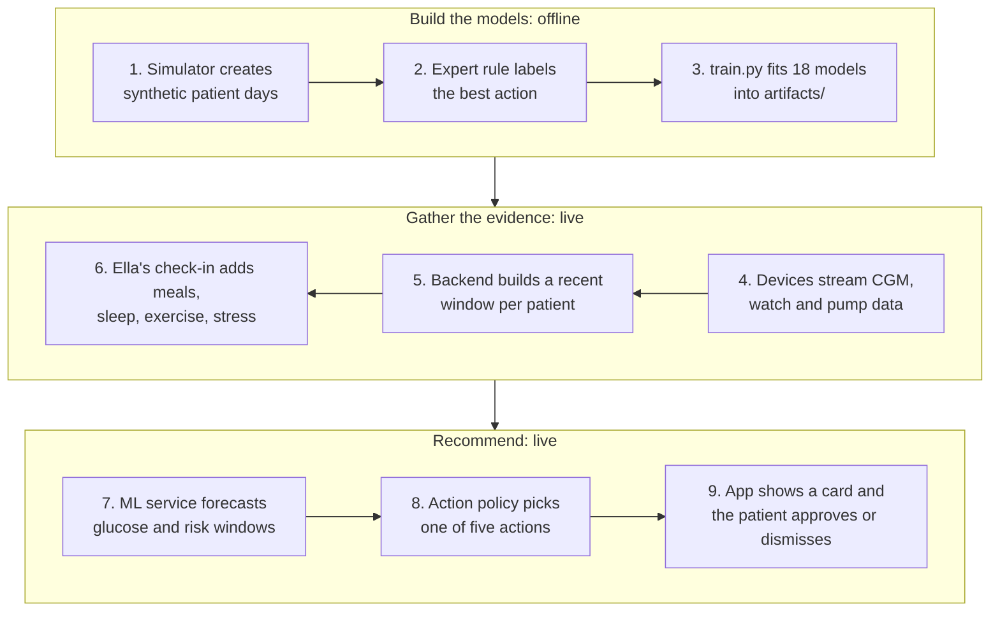

# GlucoLoop

GlucoLoop is a hackathon prototype that combines device readings and short
conversational check-ins to forecast where blood glucose is heading. The
immediate focus is understanding glucose variation and producing useful
forecast signals. It also includes experimental pump-action suggestions based
on simulated data. These are not validated treatment instructions, and
GlucoLoop never changes a physical pump on its own.

## What problem this solves

An insulin pump user makes dozens of small decisions a day. They decide whether
to eat, whether to correct a high reading, whether to trust a sensor that looks
odd, or whether to turn insulin down before exercise. Today they make these
decisions by combining three sources by hand. The first is the glucose sensor.
The second is the pump's own record of the insulin it has delivered. The third
is what they know about their own day, such as a large lunch or a poor night's
sleep.

GlucoLoop puts all three sources together. It reads the devices continuously,
gathers the personal context through a friendly chat assistant called Ella, and
feeds both into machine-learning models. The models do two jobs. They forecast
glucose over the next hour and the next day, and they suggest one of five pump
actions. Because a chat answer changes the models' inputs, telling Ella "I just
ate 60 g of carbohydrate" can affect the forecasts and change the
recommendation.

## Glossary

| Term | Meaning |
|---|---|
| CGM | Continuous glucose monitor. A skin sensor that reports glucose every 5 minutes, in mg/dL. |
| Basal | The slow, steady background insulin a pump delivers all day. |
| Bolus | A one-off dose, usually for a meal or to correct a high reading. |
| IOB | Insulin on board: insulin already delivered and estimated still active. It is not insulin left in the pump. |
| Feature vector | The fixed list of numbers describing "the situation now" that every model receives. |
| Fusion service | The backend that merges device readings and chat answers into that feature vector. |
| Envelope | A low-to-high band that glucose is expected to stay within during a time block. |
| q10 / q90 | Estimated 10th and 90th percentiles. The intended tail frequencies still need checking against real observations. |
| Device fault | A sensor that drifts or drops out, or a blocked pump line (an "occlusion"). |

## How it works

The diagram shows the process in reading order. The top row happens once,
offline, to build the models. The second and third rows happen continuously
while the demo runs. Read the middle row from right to left.



| Boxes | Where it lives | Command |
|---|---|---|
| 1 | `services/simulator/generate_dataset.py` | `python generate_dataset.py ...` |
| 2 and 3 | `services/ml/train.py` | `python -u train.py` |
| 4 | `services/simulator/live_stream.py` | `python live_stream.py ...` |
| 5 and 6 | `services/backend/` | `node src/server.js` |
| 7 and 8 | `services/ml/predict_api.py` | `python predict_api.py` |
| 9 | `apps/mobile/` | `npx expo start` |

## How the models learn

Real patient data is hard to obtain for a hackathon, so the training data comes
from a physiological simulator. It is built on the Bergman minimal model, a
standard set of equations describing how glucose and insulin interact in the
body. On top of that, it adds meals, exercise, stress, sleep and deliberate
device faults, and it produces many labelled days of synthetic patients.

The action labels come from a handwritten rule. While generating data, the
simulator knows what happens next under its own assumptions. The rule uses
that future to assign a category, rather than a clinician establishing the
correct action. The action model learns to reproduce that choice using information
that would be available in real time. In effect, the model learns to act as if
it could see the future, without actually seeing it. This is also its main
weakness. It can only be as good as the expert rule, and only within the kinds
of situations the simulator produces.

There are 18 models, all scikit-learn gradient-boosted trees, and each is
trained separately:

| Models | Count | Output |
|---|---|---|
| Point forecasts | 5 | Glucose 5, 15, 30, 45 and 60 minutes ahead |
| Day envelope | 12 | For each of the next six 4-hour blocks, the q10 of the lowest glucose and the q90 of the highest. Blocks that may go too low or too high become "risk windows". |
| Action policy | 1 | One of `no_op`, `alarm_only`, `reduce_basal`, `suspend`, `correction_bolus` |

The prediction service loads all 18 model files on its first health check or
prediction request. If any file is missing, that request fails with an error
rather than quietly returning partial results. Evaluation results on separate
held-out scenarios are in `docs/METRICS.md`. On main's committed simulated data,
the one-hour forecast is off by 3.9 mg/dL on average. The action policy has
examples of all five classes in training and 95.4% evaluation accuracy. However,
evaluation has no true `suspend` or `correction_bolus` cases, so it cannot tell
us how reliably the model recognizes those actions. These results do not
establish performance on real patients.

## Running it

The full workflow needs Python 3.11+ and Node 22. Each service runs in its own terminal. Start them in this order, because each
one calls the one before it. Main tracks generated datasets and model files,
but this PR preserves its incoming binaries rather than committing replacements.
Train once before serving so the saved models match the updated feature builder.

```bash
# 1) ML prediction service on port 8101, from services/ml
pip install -r requirements.txt
python -u train.py              # fits and evaluates all 18 models on the supplied data
python predict_api.py            # or: uvicorn predict_api:app --port 8101

# 2) Backend fusion service and chat agent on port 8100 (Node 22, no installs), from services/backend
node src/server.js               # set MISTRAL_API_KEY for the real Ella, otherwise a scripted mock is used

# 3) Simulated devices, from services/simulator
#    --accel 60 plays one simulated minute per real second
python live_stream.py --backend http://127.0.0.1:8100 --patient demo-001 --accel 60

# 4) Mobile app (Expo, a tool for running React Native apps on a phone), from apps/mobile
EXPO_PUBLIC_API_URL=http://<your-computer's-local-network-IP>:8100 npx expo start
```

To check that the ML service is up, run `curl http://127.0.0.1:8101/health`,
which should return a small JSON status. The simulator in step 3 injects
scripted faults so that the demo shows the safety behaviour. CGM drift starts
at simulated minute 600, a pump occlusion at 1500 and a CGM dropout at 2100.

### Retraining from scratch

```bash
(cd services/simulator && python generate_dataset.py --n-train 24 --n-eval 6 --days 3)
(cd services/ml && OMP_NUM_THREADS=2 python -u train.py)   # rewrites models and docs/METRICS.md
```

Training runs four worker processes in parallel. Each worker limits its
numerical libraries to `OMP_NUM_THREADS` threads (two by default) and prints
the limit it actually applied. Without that limit, four workers would each grab
every CPU core and slow one another down. Each model is saved as soon as it
finishes. The verified run on 24 training and six evaluation scenarios used
20,318 and 5,041 usable rows respectively and finished in 1.816 seconds. Windows
without any usable sensor reading are excluded during training and rejected
when predicting, rather than filled from future observations.

## Proactive low-glucose watch (Ella reaches out first)

A background pass in the backend (`PROACTIVE_CHAT_INTERVAL_S`, default 30 s) detects
low or fast-dropping glucose **and** a predicted horizon minimum below threshold
(cached ML forecast), then initiates a chat turn through the agent with a
`[SYSTEM EVENT …]` message — so the warning is composed by Ella in mock and real
(Mistral) mode alike. If the patient doesn't reply within the response window, the
no-response protocol escalates (critical alert). Thresholds live in
`services/scenario/config.low_watch.json` (env-overridable via `PROACTIVE_*`).


## Questions and situations for the demo

These are presentation questions, not guaranteed Ella chat commands. The trained
forecaster uses recent device readings and recorded context. Its training and
evaluation are simulated; these examples do not establish patient accuracy.

| Example question | What can answer it now | Limit to explain |
|---|---|---|
| “Where is glucose heading in the next 30 minutes?” | Trained point forecasts at 5, 15, 30, 45 and 60 minutes. | Requires readings; not a clinical guarantee. |
| “Which parts of the next day might be high or low?” | Six four-hour envelope blocks. | Estimated bounds, not validated probabilities or a precise five-hour forecast. |
| “I ate 60 g of carbohydrate. Does that change the forecast?” | A recorded check-in can change model inputs and the next prediction. | Effects are learned from the simulator, not real patients. |
| “What might a meal, exercise or stress response look like?” | The separate `/demo` chart has meal, moderate exercise, intense exercise and stress examples. | Sizes and timing are invented assumptions; intense exercise can increase glucose. |
| “What if this person responds more strongly than our starting estimate?” | Add completed simulated observations in `/demo` to adapt that event's curve. | Temporary browser demonstration; it does not personalise the eighteen trained models. |
| “How would a poor night's sleep, a period or menopause affect me?” | Sleep is an existing simulated-model input; cycle and menopause inputs are absent. | No measured personal response is established for any of these. |
| “How much insulin should I take, or should I carry a spare?” | Neither is answered by the new demonstration. | Treatment is unvalidated; spare planning lacks stock and inventory inputs. |

For a standalone presentation, run this from the repository root with Node 22:

```bash
npm run demo --prefix services/backend
```

Open `http://localhost:18130/demo`. No trained models or credentials are needed.
Choose **Moderate exercise** and add four simulated observations: the initial
-20 mg/dL peak change adapts to -25, toward a simulated personal change of -30.
These are absolute changes, not percentages or literature averages. Each event
learns separately; reset clears that event and reload clears all histories. The page
never changes insulin delivery. See `docs/DEMO_SCRIPT.md` for the walkthrough
and `docs/OPENHUMANS_TOOLS.md` for sources and data-access limits.
`docs/DEMO_SCRIPT.md` also includes clone instructions for a colleague's computer;
the standalone launcher works with Windows, macOS and Linux command syntax.

## Configuration and tests

Settings live in `services/ml/config.toml` rather than in the code. The file
sets the forecast horizons, the number and length of the day blocks, the
worker and thread counts, and the latency benchmark targets. Change values
there, then retrain.

From `services/ml`, `python -m unittest test_features test_prediction test_training`
runs the tests. None of them call external services. `python benchmark.py`
measures prediction response times and writes `docs/LATENCY.json`. The
target is that 95% of requests finish within 100 ms.
The final local benchmark measured 8.32 ms at that percentile over 100 requests
with no failures. It does not measure mobile or internet response time.

From the repository root, `python tests/integration/ml_flow.py` starts isolated
backend and ML services, streams 185 simulated minutes, and checks forecasts,
mock chat check-ins and sensor/service failures. It requires the saved models,
the ML Python dependencies and Node.js. It calls no paid APIs, uses separate
in-memory patient history, and stops its own services. Results are saved to
`docs/INTEGRATION.json`.

Hormonal, menstrual and menopausal context is longer-term research; those inputs
are not represented in the current models. No real OpenAPS records have been
acquired. The separate simulation personalisation page is described above.
The proposed five-hour spare-vial/pen
planning feature is separate and has not been implemented. It needs
remaining-stock and spare-inventory inputs that current messages do not carry.
See `docs/PR_REVIEW_NOTES.md` for the scope clarification and the explanation of
how the Bergman simulator already supplies training data to the learned models.

## Repository layout

| Path | Contents | Owner [delete this column after the hackathon] |
|---|---|---|
| `services/simulator/` | Physiology model, fault injection, data generation, live stream | Eng 1 |
| `services/backend/` | REST API, fusion window, Ella agent and its tools | Eng 2 |
| `services/ml/` | Training, prediction API, config, tests, benchmark | Eng 3 |
| `apps/mobile/` | Expo app with recommendation cards | Eng 4 |
| `packages/contracts/index.ts` | Shared payload types. Update these if you change a payload. | Team |
| `docs/` | `DEMO_SCRIPT.md`, `METRICS.md`, `LATENCY.json`, `WORK_PLAN.md` | Presenter |
| `services/scenario/` | Scripted low-glucose scenario and watcher; see its README | Scenario team |

`DESIGN_CHOICES.md` records why things were done a certain way, and
`DEFERRED_WORK.md` lists agreed work that has not been done yet.

## Known limitations

- All state is held in memory, so restarting the backend loses it. That is fine
  for a demo, and a store such as Redis would fix it later.
- Without `MISTRAL_API_KEY`, Ella is a keyword-matching script rather than a
  language model. Both versions call the same tools, so the rest of the system
  behaves identically.
- Every model is trained on simulated physiology. It is a draft of a learned
  policy, not a clinical instrument.
- Class coverage depends on the generated training scenarios. Read the trained
  and missing classes in `docs/METRICS.md` before interpreting action accuracy.
- The inherited models on main may predate the current feature construction.
  Run training before serving; this PR does not refresh main's tracked binaries.
- `docs/BACKEND.md` and `docs/schemas.MD` describe main's additional backend APIs.

## Safety stance

GlucoLoop **recommends** and the patient **approves**. It never doses
automatically. When a device looks untrustworthy, because of drift, dropout or
occlusion, the simulator's rule labels it `alarm_only`. The learned classifier
is not a guaranteed enforcement of that rule. All guidance
is labelled "not medical advice" in the app.
